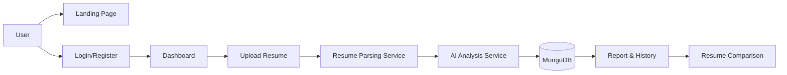

# AI Resume Analyzer

A modern AI-powered resume analysis application built with Node.js, Express.js, MongoDB, and vanilla JavaScript. It enables users to upload a PDF or DOCX resume, compare it to a selected role or job description, and receive estimated ATS compatibility, skill-gap feedback, and AI-generated recommendations.

## Overview

The application aligns with a professional SaaS workflow:

Register → Login → Dashboard → Upload Resume → Analyze → ATS Score → Skill Detection → Missing Skills → Recommendations → Save Analysis → History → Compare

## Features

- User registration and login with JWT authentication
- Password hashing using bcryptjs
- Protected routes and secure token validation
- Resume upload for PDF and DOCX files
- Text extraction with `pdf-parse` and `mammoth`
- Role-based or custom job-description analysis
- Estimated ATS compatibility scoring
- Skill extraction and missing-skill detection
- AI recommendation generation based on actual resume content
- Persistent analysis history using MongoDB
- Modern responsive dashboard and landing pages

## Tech Stack

- Frontend: HTML, CSS, Vanilla JavaScript, Chart.js
- Backend: Node.js, Express.js, REST API
- Database: MongoDB + Mongoose
- Authentication: JWT + bcryptjs
- Resume parsing: PDF and DOCX parsers

## System Architecture



## Screenshots

The project includes a modern SaaS-style landing page, auth screens, and dashboard experience. Add screenshots here later once the project is running locally.

## Installation

1. Clone the repository.
2. Install backend dependencies:

```bash
cd backend
npm install
```

3. Create or update the root `.env` file using `.env.example`.
4. Start MongoDB locally or configure a remote MongoDB connection.
5. Run the server:

```bash
npm run dev
```

6. Open the app in the browser at `http://localhost:5000`.

## Environment Variables

Example variables are located in `.env.example`.

```env
PORT=5000
MONGODB_URI=mongodb://localhost:27017/resumeai
JWT_SECRET=replace_with_a_secure_secret
AI_API_KEY=your_api_key_here
AI_PROVIDER=local
```

## Running Locally

```bash
cd backend
npm install
npm run dev
```

The frontend is served from the root project and is available on the same Express instance.

## API Documentation

### Authentication

- POST `/api/auth/register`
- POST `/api/auth/login`
- GET `/api/auth/me`

### Resume Management

- POST `/api/resumes/upload`
- GET `/api/resumes`
- GET `/api/resumes/:id`
- DELETE `/api/resumes/:id`

### Analysis

- POST `/api/analysis`
- GET `/api/analysis`
- GET `/api/analysis/:id`
- DELETE `/api/analysis/:id`

### User Profile

- GET `/api/users/profile`
- PUT `/api/users/profile`

## Database Structure

### User
- name
- email
- password
- createdAt

### Resume
- userId
- fileName
- filePath
- extractedText
- targetRole
- uploadedAt

### Analysis
- userId
- resumeId
- targetRole
- atsScore
- matchScore
- matchedSkills
- missingSkills
- strengths
- weaknesses
- keywordAnalysis
- recommendations
- createdAt

## Future Scope

- AI-powered resume rewriting
- LinkedIn profile analysis
- Job recommendation system
- Multiple LLM support
- Resume template generation
- Interview preparation
- Personalized learning roadmap
- Skill demand analysis
- Job-market analytics

## Contributors

- ResumeAI Team

## License

This project is licensed under the MIT License.
